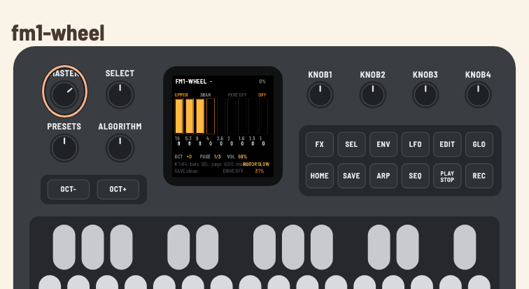

# WheelBox — hardware manual

[Português](MANUAL.md) · **English**

Tonewheel organ firmware for the **M-VAVE FM-1**, derived from
[setBfree](https://github.com/pantherb/setBfree), running on
[fm1-base](https://github.com/charlesvestal/fm1-base).

> **Status:** the firmware builds for the FM-1 and passes the build checks, but
> it has **not been tested on hardware yet**. The host simulator and the web
> emulator run the full chain (tone generator, scanner, preamp, reverb and
> Leslie). This manual describes the intended/implemented behaviour; keyboard
> and performance details may change after the first device test.

---

## 1. Install

The firmware is installed over USB-MIDI. Connect the FM-1 with a USB **data**
cable and close any other application using its MIDI ports.

```sh
make device          # builds app/build/wheelbox.fwsc
make install         # shows the device and asks before writing
```

You can also use the project's web installer (Chrome/Edge) or run
`fm1_install.py` directly. Installing firmware is at your own risk. Keep the
official firmware and the recovery tools
(`fm1-base/bsp/tools/fm1_rescue.py`, `FM-1-transporter`) at hand.

If the install is interrupted, the FM-1 stays in update mode and the same
command finishes the write. To go back to the official firmware, use M-VAVE's
updater or the web installer.

---

## 2. Power on and play

The FM-1 has **27 keys** (F3–G5), 7 encoders, 14 buttons, a MASTER pot and a
240×240 screen.

- The keys play the **upper manual** by default.
- `OCT-` / `OCT+` transpose the built-in keyboard by up to ±2 octaves. External
  MIDI is **not** transposed by these buttons.
- The MASTER pot controls the output level.
- An external MIDI controller (USB or TRS) can play any manual; see section 5.



The screen shows:

- **header:** name, the note that is sounding, and CPU load;
- **body:** selected manual, registration, percussion, vibrato and the nine
  drawbar columns with the 16', 5⅓', 8', 4', 2⅔', 2', 1⅗', 1⅓', 1' footages;
- **footer:** octave, page, volume, rotor, SAVE state, drive and reverb.

---

## 3. Buttons and encoders

### Encoders

| Encoder | Function |
|---|---|
| `SELECT` | edit page: 0 = bars 0–3, 1 = bars 4–7, 2 = bar 8 + percussion |
| `ALGO` | manual being edited: UPPER, LOWER, PEDAL |
| `PRESET` | eight factory registrations; applies to the selected manual |
| `K1`–`K4` | edit the four bars of the current page |

On page 2, `K1` edits the 1' bar and `K2`–`K4` control percussion (on/off),
harmonic (2nd/3rd) and decay (fast/slow).

### Buttons

| Button | Function |
|---|---|
| `FX` | drive on/off (preamp/overdrive) |
| `SEL` | next drawbar page |
| `ENV` | percussion on/off |
| `LFO` | vibrato/chorus cycle: OFF → V1 → C1 → V2 → C2 → V3 → C3 |
| `EDIT` | next manual: UPPER → LOWER → PEDAL |
| `GLO` | **drawbar-key mode** (section 4); its LED is lit while the mode is on |
| `HOME` | back to registration 0 (3BAR) |
| `SAVE` | write the settings to flash |
| `ARP` | percussion 2nd/3rd harmonic |
| `SEQ` | reverb cycle: OFF → 30% → 60% → 100% |
| `PLAY` | rotor: STOP → SLOW → FAST |
| `REC` | reserved (no function in this version) |
| `OCT-` / `OCT+` | transpose the built-in keyboard (−2..+2 octaves) |
| `MASTER` | output volume |

The labels printed on the FM-1 are the stock ones; the screen shows the real
function of each control.

### Factory registrations

| # | Name | Bars |
|---|---|---|
| 0 | 3BAR | 888000000 |
| 1 | BLUES | 888800000 |
| 2 | ROCK | 888000008 |
| 3 | TOPS | 800000888 |
| 4 | FLUTE | 008000000 |
| 5 | FULL | 888888888 |
| 6 | BASS | 858000000 |
| 7 | STRNG | 006876540 |

The registration is applied to the selected manual (`ALGO`/`EDIT`).

---

## 4. Drawbar-key mode (the keyboard as a controller)

`GLO` turns on/off the mode in which the 27 keys stop playing and edit the
drawbars of the selected manual. It is the equivalent of the programming mode
on older clonewheel organs.

- **Mode on:** the built-in keys **do not play**; each press raises or lowers
  one drawbar by one position. External MIDI **keeps playing** — you can play
  from a controller and use the FM-1 keyboard to edit the registration.
- **Mode off:** the keys play normally again.
- The mode is not saved: it starts off at the next boot.
- Drawbar changes mark `SAVE`; press `SAVE` to store them.

### Key map

Each pair **flat (black key) / natural (white key)** controls one drawbar:

| Pair | Drawbar | Action |
|---|---|---|
| F#3 / G3 | 16' | F# up, G down |
| G#3 / A3 | 5⅓' | G# up, A down |
| A#3 / B3 | 8' | A# up, B down |
| C#4 / D4 | 4' | C# up, D down |
| D#4 / E4 | 2⅔' | D# up, E down |
| F#4 / G4 | 2' | F# up, G down |
| G#4 / A4 | 1⅗' | G# up, A down |
| A#4 / B4 | 1⅓' | A# up, B down |
| C#5 / D5 | 1' | C# up, D down |

- **F3, C4, F4 and C5** are ignored.
- **D#5, E5, F5, F#5 and G5** are free (no function in this version).
- In drawbar mode all **18 control keys light equally**; the ignored/free keys
  stay dark. The key position (black = up, white = down) shows the direction.
- Each press changes one step (0..8). The value appears in the corresponding
  column on the screen; at 0 or 8 the key does not go past the limit.
- The edited manual is the one shown at the top of the screen
  (`UPPER`/`LOWER`/`PEDAL`); use `EDIT` or the `ALGO` encoder to change it.

To play from the built-in keyboard again, press `GLO` again. If a key is held
while switching, it is released and only sounds again after being released and
pressed again.

---

## 5. MIDI

The FM-1 has USB-MIDI (in/out) and a TRS-MIDI input; there is no DIN output.

| Channel | Manual |
|---|---|
| 1 | upper |
| 2 | lower |
| 3 | pedal |

### Control Changes

| CC | Function |
|---|---|
| 1 / 11 | swell (volume) |
| 70–78 | upper drawbars: 16', 5⅓', 8', 4', 2⅔', 2', 1⅗', 1⅓', 1' (0 = maximum, 127 = minimum) |
| 80 | percussion on/off (≥64 on) |
| 81 | decay fast/slow (≥64 fast) |
| 82 | percussion 2nd/3rd (≥64 2nd) |
| 64 | rotor slow/fast (≥64 toggles) |
| 65 | drive on/off (≥64 on) |
| 92 | vibrato: 0..127 → OFF/V1/C1/V2/C2/V3/C3 |
| 93 | drive character |
| 95 | vibrato routing: 0 off, 32 lower, 64 upper, 96 both |

Program Change 0–7 selects one of the eight registrations.

The drawbar map is setBfree's (inverted: 0 = maximum). An external drawbar
controller works without extra configuration, including in drawbar-key mode.

---

## 6. What is saved

`SAVE` writes to flash:

- the octave;
- the swell;
- all 27 drawbars (upper/lower/pedal);
- percussion (on/off, 2nd/3rd, fast/slow);
- the selected registration;
- vibrato (mode);
- drive and character;
- reverb;
- rotor (stop/slow/fast).

Not saved: drawbar-key mode, the edit page and the selected manual (they return
to their defaults at boot).

---

## 7. Troubleshooting

| Symptom | What to check |
|---|---|
| No sound | MASTER, audio cable, `PLAY`/rotor, amplifier volume; in drawbar mode the keys do not play (press `GLO`) |
| Keys do not play | drawbar-key mode is on (`GLO` lit) |
| Stuck note | release and press the key again; if it persists, power-cycle the FM-1 |
| External MIDI does not play | channel 1/2/3, USB data cable, another app using the port |
| Installer cannot find the FM-1 | USB data cable, close DAWs/MIDI apps; check `fm1_install.py --info` |
| Install interrupted | reconnect and run `make install` again; the FM-1 stays in update mode |
| Distorted sound | lower MASTER, drive or the registration (FULL); the app's limiter acts on peaks |

---

## 8. Development

```sh
make build-host      # host simulator
make test-host       # app tests (keys, drawbars, MIDI, persistence)
make web             # browser emulator (Emscripten)
make serve-web       # http://localhost:8790/
make compare         # A/B against setBfree
make device          # firmware for the FM-1
make install         # writes it to the connected FM-1
```

The web emulator runs the same C code as the firmware; use Cmd+Shift+R to
load a new wasm after `make web`.

---

## 9. Licence and trademarks

The firmware is **GPL-3.0-or-later**. setBfree is GPL-2.0-or-later; fm1-base
and felucca-bsp are MPL-2.0; the JieLi SDK files are Apache-2.0. See
`LICENSING.md` and `LICENSES/`.

“Hammond”, “B3” and “Leslie” are trademarks of their owners. WheelBox is not
affiliated with or endorsed by them. Use “tonewheel organ” and “rotary
speaker” in public material.
